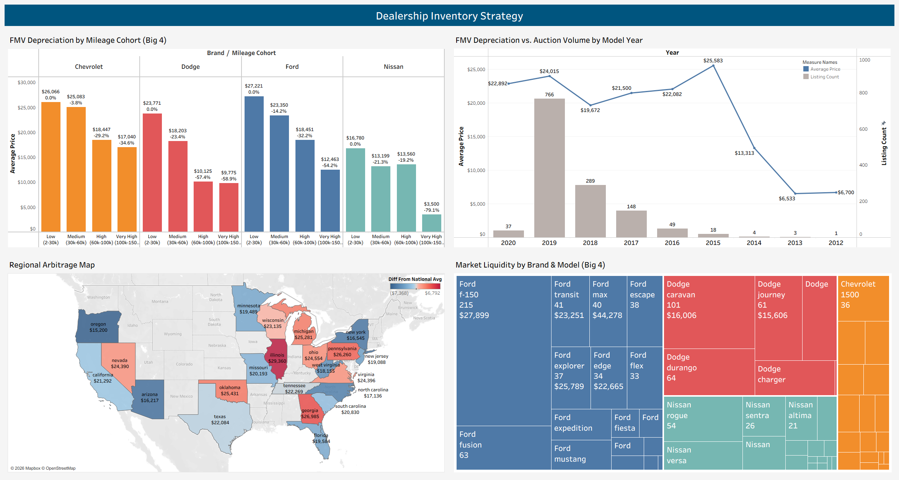

# Dealership Inventory Strategy: Wholesale Valuation, Depreciation & Regional Arbitrage

> **Deliverables:** [Interactive Tableau Public Dashboard](#) | [Full Executive Case Study (PDF)](./deliverables/case_study_report.pdf) | [Kaggle Source Dataset](https://www.kaggle.com/datasets/doaaalsenani/usa-cers-dataset)

## Overview

An end-to-end analytics pipeline modeling ~2,500 U.S. wholesale vehicle auction records (`AUCTION EXPORT.com`, ~2020) to establish Fair Market Value (FMV) benchmarks, measure brand-level mileage and age depreciation, evaluate model liquidity vs. capital cost, and uncover regional price arbitrage.

**Tech Stack:** `Python (pandas, SQLAlchemy)` · `PostgreSQL (Window Functions & Subqueries)` · `Tableau`

## Dashboard Preview



*2x2 executive dashboard built on four independent, pre-aggregated PostgreSQL exports. [Explore the interactive version on Tableau Public →](#)*

## Executive Takeaways (TL;DR)

* **Brand Mileage Cliffs:** Chevrolet retains value best (`-3.77%` Low to Medium; `-34.63%` at 100k+ miles), while Dodge drops sharply to `-57.41%` at High mileage (`$10,125`) and Nissan collapses `-78.14%` (`$3,650`) past 100k miles.
* **Model-Year Sweet Spot & Volume Trap:** Reliable supply sits in **2016–2020** (peaking at `766` listings in 2019), with **2018** offering an `-18.08%` (`-$4,343`) discount at `$19,672` (`289` units). Pre-2016 swings (`2015` spike and `2012–2014` drops) stem from thin samples (`1–18` listings/year).
* **Regional Arbitrage Spreads:** Across states with `>10` listings, wholesale averages range from **`-$7,958` below** to **`+$6,753` above** the U.S. national baseline, with Western and high-volume Southern markets frequently clearing below average.
* **Liquidity vs. Capital Efficiency:** Supply concentrates in anchor models like the Ford F-150 (`215` units, `$27,899`) and Dodge Caravan (`101` units, `$16,006`). At nearly identical supply, a buyer can stock ~3 Ford Escapes (`38` units at `$14,463`) for the capital cost of 1 Ford Max (`40` units at `$44,278`).

*For the full stakeholder narrative, brand-specific buying matrix, and next-phase recommendations, read the [Executive Case Study (PDF)](./deliverables/case_study_report.pdf).*

## Technical Architecture

### 1. Data Cleaning & Database Ingestion (`Python / Jupyter / SQLAlchemy`)

Before modeling in PostgreSQL, the raw dataset is audited, cleaned, and loaded through three Python components:

* **`data_cleaning.ipynb`:** Drops `$0` price records (incomplete/canceled auctions) and `0`-mileage entries; removes extreme price/mileage outliers (hyper-exotics and total-loss scrap); filters to model years **2012–2020** (10-year ceiling aligned with prime retail financing); and strips web-scraping artifacts (whitespace, truncated trims, `"door"`/`"doors"` fragments) from `state` and `model`.
* **`salvage_check.ipynb`:** Audits title status (`clean vehicle` vs. `salvage insurance`) to validate pricing distortion and confirm title-filtering assumptions.
* **`db_load.py`:** Automates loading the cleaned dataset from `data/` into PostgreSQL using `SQLAlchemy` and `psycopg2`.

### 2. Multi-Grain SQL Modeling (`PostgreSQL`)

Each business question runs at a different analytical grain, so transformations are isolated into four modular queries rather than one flattened table—eliminating join fan-out and preserving exact window denominators:

| Script | Output Grain | Key SQL Techniques | Output Metrics |
| :--- | :--- | :--- | :--- |
| [`state_avg_prices.sql`](sql/state_avg_prices.sql) | 1 row / `state` | Scalar subquery baseline, `WHERE country = 'usa'`, `HAVING COUNT(*) > 10` | `avg_price`, `diff_from_national_avg`, `listing_count`, `avg_year`, `avg_mileage` |
| [`age_depreciation.sql`](sql/age_depreciation.sql) | 1 row / `year` | `LAG() OVER (ORDER BY year DESC)`, `NULLIF()` zero-division guard | `avg_price`, `listing_count`, `avg_mileage`, `yoy_price_change`, `yoy_pct_change` |
| [`fmv_by_cohorts.sql`](sql/fmv_by_cohorts.sql) | 1 row / `brand` + `mileage_cohort` | Searched `CASE` bucketing, `LAG()` & `FIRST_VALUE()` partitioned by `brand` | `avg_price`, `listing_count`, `price_change_prev_tier`, `pct_change_from_low` |
| [`market_liquidity_volume.sql`](sql/market_liquidity_volume.sql) | 1 row / `brand` + `model` | Unfiltered `SUM(total_count) OVER ()`, `DENSE_RANK() OVER (PARTITION BY brand ...)` | `total_count`, `avg_price`, `pct_of_total_volume`, `brand_volume_rank` |

**Key Engineering Decisions:**

* **True Market Share Denominator:** `market_liquidity_volume.sql` intentionally leaves out brand and minimum-count filters so `SUM(total_count) OVER ()` calculates each model's true share of the *entire* cleaned auction market; scoping to the Big 4 happens downstream in Tableau without distorting percentages.
* **Dual Window Benchmarking:** `fmv_by_cohorts.sql` combines `LAG()` (tier-to-tier dollar drop) with `FIRST_VALUE()` (cumulative percentage depreciation anchored to each brand's `Low 2k–30k` baseline).

### 3. Visualization Architecture (`Tableau`)

* **Independent Data Sources:** Loaded all four CSV exports from `dashboard_exports/` as separate data sources matching their native pre-aggregated grains to prevent cross-grain blending errors.
* **Design System:** Unified a colorblind-safe categorical palette across brand views (Ford `#2B5C8F`, Dodge `#C85A32`, Chevrolet `#D9A026`, Nissan `#2E8B7E`), locked a zero-centered diverging scale on `diff_from_national_avg`, and paired `Average Price` over muted `Listing Count` bars with a fixed secondary axis (`1,000`) to avoid label collisions.

## Repository Structure

```text
dealership-inventory-strategy/
├── dashboard_exports/                      # Pre-aggregated CSV outputs from PostgreSQL
│   ├── agg_age_depreciation.csv
│   ├── agg_fmv_by_cohorts.csv
│   ├── agg_market_liquidity.csv
│   └── agg_regional_price.csv
├── data/                                   # Raw Kaggle dataset & cleaned CSV output
├── deliverables/                           # Final stakeholder reports & visualization assets
│   ├── case_study_report.pdf               # Executive Case Study report
│   ├── dealership_dashboard.png            # High-res 2x2 Tableau dashboard export
│   └── dealership_inventory_strategy.twbx  # Packaged Tableau workbook
├── sql/                                    # Modular PostgreSQL analysis scripts
│   ├── state_avg_prices.sql
│   ├── age_depreciation.sql
│   ├── fmv_by_cohorts.sql
│   └── market_liquidity_volume.sql
├── data_cleaning.ipynb                     # Data hygiene, outlier removal & normalization
├── salvage_check.ipynb                     # Title status (clean vs. salvage) validation
├── db_load.py                              # SQLAlchemy ingestion script for PostgreSQL
├── requirements.txt                        # Python dependencies
└── README.md
```

## How to Reproduce

1. **Clone the repository & install dependencies:**
   ```bash
   git clone https://github.com/<your-username>/dealership-inventory-strategy.git
   cd dealership-inventory-strategy
   pip install -r requirements.txt
   ```
2. **Clean the data & load into PostgreSQL:** Run `data_cleaning.ipynb` (and optionally `salvage_check.ipynb`) to generate the cleaned dataset in `data/`, then configure your local PostgreSQL connection and run:
   ```bash
   python db_load.py
   ```
3. **Run PostgreSQL models:** Execute the four scripts in `sql/` and export the pre-aggregated tables into `dashboard_exports/`.
4. **Open in Tableau:** Launch `deliverables/dealership_inventory_strategy.twbx` in Tableau Desktop or Tableau Public (or explore the hosted version via the Tableau Public link above).